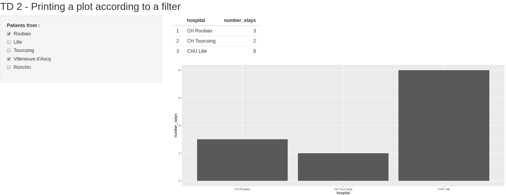

# TD 2 - Printing plot according to a filter

The objective of the TD 2 is to print a plot according to a filter.

Checkboxes allow to select the place of residence of the patient.
A barplot and a table display the number of stays per hospital, for patients previously selected.

### Results

 
